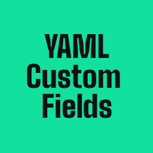

# YAML Custom Fields

[](https://github.com/maliMirkec/yaml-custom-fields)
[](https://wordpress.org/)
[](https://php.net)
[](https://www.gnu.org/licenses/gpl-2.0.html)

Add your own fields to pages, posts and every part of your site. You choose the fields. Writers fill them in. Your theme shows them.



## What the words mean

- **Field:** a box to fill in, like a title, a photo or a date.
- **Template:** a layout file in the theme, like `page.php`.
- **Schema:** the list of fields a template gets. You write it in YAML, a simple text format.
- **Site parts:** things on many pages, like the header and footer.
- **Shared fields:** one value for every page that uses the same template.
- **Site details:** one value for the whole site, like a phone number.
- **Collection:** a list of items you fill in once, like team members. Pages can pick from it.

## What it does

- **Fields for any template.** Turn fields on per template. Write the list in YAML.
- **17 field types.** Text, rich text, images, galleries, files, dates, sections and more.
- **Works in both editors.** The fields show in a "Custom fields" box in the block editor and the classic editor. One field per row.
- **Shared fields and site details.** Fill in once, use on many pages.
- **Collections.** Reusable items. Use **Save and add another** to add many in a row.
- **Site parts.** Fields for the header, the footer and other theme files.
- **Export and import.** Move fields and content to another site.
- **Content Check.** Finds missing images and files, and values left behind by removed fields.
- **REST API and a shortcode.** For JavaScript front ends, apps and block themes.
- **Settings screen.** Page caches, REST API access, and what happens when the plugin is deleted.
- **Clear messages.** Every message is easy to see and is read out to screen readers.
- **Safe.** Every value is cleaned when saved. Every action checks who you are.
- **No conflicts.** The YAML library is renamed inside the plugin, so other plugins can't clash with it.

## Field types

| Type | What it is |
|---|---|
| `string` | One line of text |
| `text` | Several lines of text |
| `rich-text` | The WordPress text editor |
| `code` | Code (HTML, CSS, JS…) |
| `boolean` | A checkbox: yes or no |
| `number` | A number, with optional min and max |
| `date` | A date, with optional time |
| `select` | A dropdown. Can allow more than one choice. |
| `taxonomy` | Categories, tags or your own taxonomy |
| `post_type` | Pick a post type |
| `data_object` | Pick an item from a collection |
| `image` | An image. `list: true` makes it a gallery. |
| `file` | Any file. `list: true` allows several. |
| `object` | A group of fields |
| `block` | Sections the writer can add, remove and reorder |
| `info` | A note for the writer. Stores nothing. |
| `section` (or `break`) | A heading with a gap above it. Stores nothing. |

## Install

**From WordPress.org**
1. Go to **Plugins → Add New**.
2. Search for "YAML Custom Fields".
3. Click **Install Now**, then **Activate**.
4. Go to **YAML CF** in the admin menu.

**From a ZIP**
1. Go to **Plugins → Add New → Upload Plugin**.
2. Pick the ZIP. Click **Install Now**, then **Activate**.
3. Go to **YAML CF** in the admin menu.

**You need**
- WordPress 6.4 or newer
- PHP 8.1 or newer
- Nothing else. The library the plugin needs is included.

## Quick start

### 1. Turn on fields for a template

1. Go to **YAML CF**.
2. Find your template, like `page.php`.
3. Switch **Custom fields** on.
4. Click **Create schema**.

### 2. Write the fields

```yaml
fields:
  - name: hero_title
    label: Hero title
    type: string
    required: true
    options:
      maxlength: 100
  - name: hero_image
    label: Hero image
    type: image
  - name: category
    label: Category
    type: taxonomy
    options:
      taxonomy: category
  - name: features
    label: Features
    type: block
    list: true
    blockKey: type
    blocks:
      - name: feature
        label: Feature
        fields:
          - name: title
            label: Title
            type: string
          - name: icon
            label: Icon
            type: image
```

### 3. Fill them in

Edit a page that uses the template. The **Custom fields** box is below the content (block editor) or below the title (classic editor).

### 4. Show them in your theme

```php
<?php
$hero_title = ycf_get_field('hero_title');
$hero_image = ycf_get_image('hero_image', null, 'full');
$category   = ycf_get_term('category');
$features   = ycf_get_field('features');
?>

<div class="hero">
  <?php if ($hero_image): ?>
    "
         alt="<?php echo esc_attr($hero_image['alt']); ?>">
  <?php endif; ?>

  <h1><?php echo esc_html($hero_title); ?></h1>

  <?php if ($category): ?>
    <span class="category"><?php echo esc_html($category->name); ?></span>
  <?php endif; ?>
</div>

<?php if (!empty($features)): ?>
  <div class="features">
    <?php foreach ($features as $block): ?>
      <?php
      $title = ycf_get_field('title', null, $block);
      $icon  = ycf_get_image('icon', null, 'thumbnail', $block);
      ?>
      <div class="feature">
        <?php if ($icon): ?>
          " alt="">
        <?php endif; ?>
        <h3><?php echo esc_html($title); ?></h3>
      </div>
    <?php endforeach; ?>
  </div>
<?php endif; ?>
```

Always escape what you print. Only code fields are meant to be printed as they are.

## Theme functions

Every function has a short `ycf_` name and a long `yaml_cf_` name. They do the same thing.

```php
ycf_get_field($field_name, $post_id = null, $context_data = null)
ycf_get_fields($post_id = null)
ycf_has_field($field_name, $post_id = null)
ycf_get_image($field_name, $post_id = null, $size = 'full', $context_data = null)
ycf_get_file($field_name, $post_id = null, $context_data = null)
ycf_get_term($field_name, $post_id = null, $context_data = null)
ycf_get_post_type($field_name, $post_id = null, $context_data = null)
ycf_get_data_object($field_name, $post_id = null, $context_data = null)
ycf_get_data_objects($object_type)
ycf_get_global_field($field_name)
ycf_get_global_fields()
ycf_has_global_field($field_name)
```

- `$post_id`: a post ID, or `'partial:header.php'` for a site part. Leave it out for the current page.
- `$context_data`: one section, when you read fields inside sections.

### A field

```php
$value = ycf_get_field('field_name');                // current page
$value = ycf_get_field('field_name', 123);           // page 123
$value = ycf_get_field('logo', 'partial:header.php'); // a site part
$value = ycf_get_field('title', null, $block);       // inside a section
```

### Does it have a value?

```php
if (ycf_has_field('hero_title')) {
  echo esc_html(ycf_get_field('hero_title'));
}
```

- Empty text or an empty list: **no**.
- An unticked checkbox (`false`) or `0`: **yes**. Those are real values.

### An image

```php
$image = ycf_get_image('field_name', null, 'full');
// ['id', 'url', 'alt', 'title', 'caption', 'description', 'width', 'height']
```

### A gallery

An `image` field with `list: true` gives a list of images, in the order the writer set.

```yaml
- name: gallery
  label: Gallery
  type: image
  list: true
```

```php
$gallery = ycf_get_image('gallery', null, 'medium');

if ($gallery) {
  foreach ($gallery as $image) {
    printf(
      '',
      esc_url($image['url']),
      esc_attr($image['alt']),
      (int) $image['width'],
      (int) $image['height']
    );
  }
}
```

### A file

```php
$file = ycf_get_file('field_name');
// ['id', 'url', 'path', 'filename', 'filesize', 'mime_type', 'title']
```

### A term

```php
$term = ycf_get_term('field_name');
// One WP_Term, or a list of them if the field allows several
```

### A post type

```php
$post_type = ycf_get_post_type('field_name');
// A WP_Post_Type, or null
```

### A collection item

```php
$university = ycf_get_data_object('field_name'); // the picked item, or null
$all        = ycf_get_data_objects('universities'); // every item
```

### Site details

```php
$phone = ycf_get_global_field('phone');
```

## Shared fields

One value for every page that uses the same template. Good for things like a disclaimer.

**Set up**
1. Go to **YAML CF**.
2. Turn on **Custom fields** for your template.
3. Click **Add shared fields** and write the fields.
4. Fill them in under **Shared content**.

**On each page**
- The shared value shows read-only, with a link to edit it.
- Below it is the page's own field.
- Tick **Use the shared value on this page** to use the shared value there.
- A template with only shared fields still shows the Custom fields box.

## Site details

One value for the whole site, like a phone number or an address.

1. Go to **YAML CF → Site details schema** and write the fields.
2. Fill them in under **YAML CF → Site details**.
3. To show them in the page editor too, tick **Use site details on these pages** for a template.
4. In the theme: `ycf_get_global_field('phone')`.

## Which value wins

`ycf_get_field()`, the REST API and the `[ycf]` shortcode all pick the first value that exists:

1. The shared value, if **Use the shared value on this page** is ticked and the shared value is filled in.
2. The shared value, for a field that is only in the shared list.
3. The page's own value. A field the writer cleared stays empty. Clearing is a choice.
4. The shared value, for a field the page was never saved with.
5. The site details value, if the template uses site details.
6. `null`, if there's nothing.

## Site parts

Headers, footers and other theme files can have fields too.

- `header.php`, `footer.php`, `sidebar.php` and similar are found on their own.
- For your own file, add `@ycf` to its top comment:

  ```php
  <?php
  /**
   * Custom navigation
   * @ycf
   */
  ```

- Then click **Refresh list** on the **YAML CF** screen.
- In the theme: `ycf_get_field('logo', 'partial:header.php')`.

## Collections

Reusable items, like universities, team members, locations or products.

1. Go to **YAML CF → Collections**.
2. Add a collection, like `universities`, and write its fields.
3. Add items. **Save and add another** saves and opens a new, empty item.
4. In a page's fields, use `type: data_object` to let writers pick an item.
5. Many items? The picker turns into a search box.

## Shortcode

For block themes, widgets or anywhere a PHP template isn't an option:

```
[ycf field="headline"]
[ycf field="hero" size="large"]
[ycf field="phone" source="site"]
```

- `field`: the field name.
- `source="site"`: read from site details.
- `size`: image size.
- `post`: another page's ID.
- `default`: text to show when the field is empty.
- Each value is escaped for what it is. An image becomes an ``.

## REST API

- Every page and post has a `yaml_cf` object: `/wp-json/wp/v2/pages/42`.
- Send a `yaml_cf` object back to save it. Only the fields you send change. Values are cleaned like in the editor.
- `/wp-json/yaml-cf/v1/site-details`: the site details.
- `/wp-json/yaml-cf/v1/collections/<name>`: a collection. Takes `page`, `per_page` (up to 100) and `search`.
- By default, site details and collections need a logged-in user who can edit posts.
- To let anyone read them, tick the box under **YAML CF → Settings → REST API**.

## Settings

**YAML CF → Settings** has three choices:

- **Page caches:** clear the cache of every page with fields when site-wide content is saved. On by default.
- **REST API:** let anyone read site details and collections without logging in. Off by default.
- **If this plugin is deleted:** keep the content in the database. Off by default, so deleting removes everything.

## For developers

### Build from source

You need PHP 8.1+ and Composer.

```bash
git clone https://github.com/maliMirkec/yaml-custom-fields.git
cd yaml-custom-fields
composer install
./build-scoped.sh
```

- `build-scoped.sh` copies the YAML library into `build/vendor/` under the name `YamlCF\Vendor`. See [BUILD.md](BUILD.md).
- **Run `./build-scoped.sh` again after you add, remove or rename a class in `src/`.** The built autoloader only knows the classes it saw.
- `build/` is in git. `vendor/` is not.

### Checks

```bash
composer check             # syntax, coding style, unit tests
composer test:integration  # tests in a real WordPress (see tests/Integration/README.md)
composer check:release     # everything, before a release
```

- 263 unit tests and 579 integration tests. All pass.
- Coding style must have zero findings.
- More in [TESTING.md](TESTING.md). Manual steps in [MANUAL-TESTING.md](MANUAL-TESTING.md).

### Where things live

- `yaml-custom-fields.php`: starts the plugin and holds the theme functions.
- `src/`: all classes (`YamlCF\` namespace). `src/Core/Plugin.php` wires them up. `src/Core/HookManager.php` adds the hooks.
- `src/Ajax/Handlers/`: the 10 AJAX actions.
- `templates/`: admin screens.
- `admin-assets/`: admin CSS and JS.
- `uninstall.php`: removes data when the plugin is deleted.

### Where data is stored

| What | Where |
|---|---|
| A page's values | Post meta `_yaml_cf_data` |
| "Use the shared value" ticks | Post meta `_yaml_cf_use_template_global_fields` |
| Templates switched on | Option `yaml_cf_template_settings` |
| Page field lists | Option `yaml_cf_schemas` |
| Shared field lists | Option `yaml_cf_template_global_schemas` |
| Shared values | Option `yaml_cf_template_global_data` |
| Site details list | Option `yaml_cf_global_schema` |
| Site details values | Option `yaml_cf_global_data` |
| Site part values | Option `yaml_cf_partial_data` |
| Collections | Option `yaml_cf_data_object_types` |
| Collection items | One option per item (`yaml_cf_do_entry_{collection}_{hash}`) plus a list per collection (`yaml_cf_do_index_{collection}`) |

Read collection items with `ycf_get_data_objects()`, not from the options.

### Filters

**`yaml_cf_field_value`**: change any value before the theme gets it. Runs for page values, shared values, site details and values inside sections.

```php
add_filter('yaml_cf_field_value', function ($value, $field_name, $post_id, $context_data) {
  if ($field_name === 'headline' && $value === null) {
    return get_the_title($post_id);
  }
  return $value;
}, 10, 4);
```

Inside the filter, use `yaml_cf_get_field_unfiltered()` to read a value without running the filter again.

**`yaml_cf_picker_threshold`**: how many choices a `taxonomy` or `data_object` field can have before it becomes a search box. Default: 50.

```php
add_filter('yaml_cf_picker_threshold', function ($threshold, $type, $key) {
  return $key === 'universities' ? 0 : $threshold; // always a search box
}, 10, 3);
```

**`yaml_cf_clear_post_caches_on_site_save`**: clear page caches after site-wide saves? Default: the Page caches choice in Settings.

**`yaml_cf_rest_public_read`**: can anyone read site details and collections over REST? Default: the REST API choice in Settings.

### Actions

- `yaml_cf_template_cache_cleared`: the template list was rebuilt.
- `yaml_cf_site_content_saved`: site-wide content was saved while per-page cache clearing is off. Purge your cache here in one go.
- `yaml_cf_log_debug`: a field list could not be read. You get the message.

## Questions

**What is YAML?**
A simple text format for lists and settings. Static site tools use it a lot. Here you use it to list your fields.

**How is this different from ACF?**
You write the fields as text. So they're easy to copy, review and keep in git.

**Does it work with my theme?**
Yes, with any theme. Block themes can use the `[ycf]` shortcode.

**Does it work with the block editor?**
Yes. The fields are in a "Custom fields" box below the content. You don't need the Classic Editor plugin.

**What if I turn the plugin off?**
Nothing is lost. The data stays.

**What if I delete the plugin?**
Everything is removed: field lists, site details, collections and page values. To keep the content, tick **Keep the content if the plugin is deleted** under **YAML CF → Settings** first.

## Contributing

1. Fork the repo.
2. Make a branch: `git checkout -b feature/my-change`.
3. Follow the WordPress coding standards. `composer check` must pass.
4. Add tests.
5. Open a pull request.

## Help

- In the admin: **YAML CF → Documentation**
- Issues: https://github.com/maliMirkec/yaml-custom-fields/issues
- WordPress.org support: https://wordpress.org/support/plugin/yaml-custom-fields/

## Changelog

The full changelog is in [readme.txt](readme.txt). That's the one WordPress.org shows.

## Privacy

The plugin sends nothing anywhere. All data stays in your WordPress database.

## Libraries

- **Symfony YAML** (6.4), MIT license (works with GPL)
  - https://symfony.com/components/Yaml
  - https://github.com/symfony/yaml/blob/6.4/LICENSE

## Credits

- **Author:** [Studio Cita](https://www.cita.hr)
- **Lead developer:** [Silvestar Bistrović](https://www.silvestar.codes)
- **Contributors:** [see all](https://github.com/maliMirkec/yaml-custom-fields/graphs/contributors)

## License

[GPL v2 or later](https://www.gnu.org/licenses/gpl-2.0.html).

```
YAML Custom Fields
Copyright (C) 2024 Silvestar Bistrovic

This program is free software; you can redistribute it and/or modify
it under the terms of the GNU General Public License as published by
the Free Software Foundation; either version 2 of the License, or
(at your option) any later version.

This program is distributed in the hope that it will be useful,
but WITHOUT ANY WARRANTY; without even the implied warranty of
MERCHANTABILITY or FITNESS FOR A PARTICULAR PURPOSE. See the
GNU General Public License for more details.
```

---

**Last updated:** 2026-09-28
**Plugin version:** 2.0.0
**Maintained by:** [Studio Cita](https://www.cita.hr)
